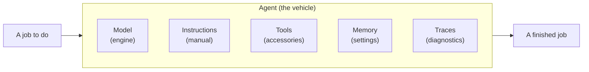

<!-- prettier-ignore -->

  

  <b><i>Find the right model by building with it.</i></b>

  
  
  
  
  

  <a href="#what-are-model-releases">What</a> &nbsp;•&nbsp;
  <a href="#why-do-they-matter">Why</a> &nbsp;•&nbsp;
  <a href="#how-can-i-get-started">Get started</a> &nbsp;•&nbsp;
  <a href="#how-can-i-learn-more">Learn more</a> &nbsp;•&nbsp;
  <a href="#where-can-i-find-the-details">Details</a>

 

## What are model releases?

A model release is the moment a new model, or a major update to one, lands in the
[Microsoft Foundry catalog](https://ai.azure.com/catalog). A release post tells us what
changed, but not how the model behaves on our own inputs or what to check when a result
surprises us.

This repository turns each release into a **capsule**: a folder with a README and
runnable notebooks. We build something, look closely at what the model did, change an
input, and practice fixing what breaks. Ready to try one? [Get started](#how-can-i-get-started),
[see what just shipped](#how-can-i-learn-more), or
[open an issue](https://github.com/microsoft-foundry/model-releases/issues/new) if we're missing a release.

 

## Why do they matter?

Think of an AI agent as a vehicle built to get a job done: the model is the engine,
instructions are the manual, tools are accessories (like power windows), memory is saved
settings, and traces are the diagnostics.

Every release adds another engine to choose from, so we can match the engine to the job.
A small electric car is plenty for a weekly grocery run, a tractor is built for fields,
and a snow-plowing business needs a heavy-duty pickup. More power isn't better if the job
doesn't need it. It just costs more.

_Models work the same way.__ Some generate images, some reason through hard problems, and
some listen and speak. Within each kind, we trade power for speed and cost. So the useful
question isn't "which model is best?" but "which one is right-sized for this job?"

_Traces help us answer it._ They record what the model was asked, what it returned, and what each step cost in time and money. That shows how it really behaves on our task. When an agent stumbles, traces become evidence we can analyze to debug problems or performance.

 

## How can I get started?

<!-- BEGIN:RECENT-CAPSULES -->

  
  
  
  
  
  
  
  
  
  
  
  

<!-- END:RECENT-CAPSULES -->

- **Setup** → [Open the repository in GitHub Codespaces](https://codespaces.new/microsoft-foundry/model-releases), then run `./scripts/1-create-rg.sh` once.
  It signs you in, creates your Foundry project with monitoring and access, and writes your `.env`
  ([quickstart](./models/quickstart/README.md)).
- **Pick a family** → Click a badge to see notebooks - if `0` try [creating the first one](./docs/README.md#contributing-how-can-i-add-new-content).
- **Try a notebook** → Deploy the model it needs with `./scripts/3-deploy-model.sh`, open the notebook in VS Code, select the kernel, and run the cells.

Not sure where to start? [MAI-Image-2.5](./models/microsoft-ai/mai-image-2.5/mai-image-2.5.ipynb) gives a visual result fast. Then change an input, test a hunch, and fix whatever breaks, because that's where most of the learning happens.

Want release summaries and update dates? Try the [CAPSULES](./docs/CAPSULES.md).

 

## How can I learn more?

Want to see what just shipped? Every release announcement is logged in
[ANNOUNCEMENTS](./docs/ANNOUNCEMENTS.md) with a link to the original post, the publisher, and the
capabilities. Here are the three most recent:

<!-- BEGIN:RECENTLY-ADDED -->
- **Microsoft-Decision-1** · [2026-10-09](https://techcommunity.microsoft.com/blog/azure-ai-foundry-blog/introducing-microsoft-decision-1-in-microsoft-foundry-for-decision-and-classific/4562742) · Decision Models
- **Claude Haiku 5.5** · [2026-10-07](https://techcommunity.microsoft.com/blog/azure-ai-foundry-blog/claude-haiku-5-5-is-now-available-in-microsoft-foundry/4562408) · Chat Completion · Multimodal · Function Calling
- **Grok 4.7** · [2026-10-06](https://techcommunity.microsoft.com/blog/azure-ai-foundry-blog/introducing-grok-4-7-on-microsoft-foundry/4562168) · Reasoning · Chat Completion · Function Calling
<!-- END:RECENTLY-ADDED -->

 

## Where can I find the details?

- [Reference guide](./docs/README.md): how repo is organized, plus a glossary of terms
- [Contribute content](./docs/README.md#contributing-how-can-i-add-new-content): add a capsule, publisher, capability, or glossary term
- [Use it from an agent](./docs/README.md#using-this-repo-from-an-agent): fetch repo data through `catalog.json` or `llms.txt`
