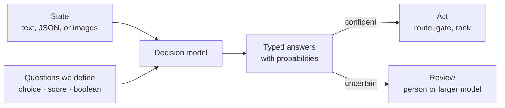

# Decision Models

> **Ask a question, get a typed answer.** A decision model doesn't write a reply.
> It returns a choice, a score, or a probability that our application can act on.

Many steps in an AI application are small judgments: which team should handle
this request, how urgent is it, is the customer asking for a refund? A decision
model, called through a decision API, is built for exactly those steps.



## How does a decision API work?

We send **state**, the evidence the model should consider, and one or more named
**questions**. We get one typed answer per question. Each question asks for one
judgment we can check against the state.

| Question type | We ask | We get back |
|---|---|---|
| Choice | Which of these options fits? | The best option, with a probability for each option when the model provides it |
| Score | Where does this fall on an ordered rubric? | A position on the scale, which can fall between levels |
| Boolean | Is this statement true? | The probability of yes, from 0 to 1 |

Providers name the boolean type differently: Boolean, noul, or predicate. A
boolean near zero means the model favors no. It does not mean the model is
unsure.

Here is the request shape for [Microsoft-Decision-1](https://ai.azure.com/catalog/models/Microsoft-Decision-1)
on Foundry, from the announcement's sample code:

```json
{
  "model": "<our deployment name>",
  "state": "I was charged twice for one order. Please refund the extra payment.",
  "questions": {
    "team": {
      "type": "choice",
      "instructions": "Which team should handle this customer support request?",
      "criteria": {
        "billing": "Charges, invoices, refunds, or subscription payments",
        "technical": "Software errors, bugs, or integration failures",
        "account": "Sign-in, password, or account-access problems"
      }
    }
  }
}
```

Several questions can share the same state in one call. If a later question
needs an earlier answer, our code passes that answer into a second call.

A few habits make answers easier to trust:

- Add a "review" or "insufficient evidence" option, so a forced choice doesn't
  hide missing information.
- If several labels can apply, ask separate boolean questions.
- Keep exact checks in code. If a record already has a trusted `refunded` field,
  read it. Use the model for judgments that need interpretation, such as whether
  a customer is asking for a refund.

## Who offers one today?

The decision API pattern is new, and several providers shipped it within weeks
of each other:

| Model or service | Access | What stands out |
|---|---|---|
| [Microsoft-Decision-1](https://ai.azure.com/catalog/models/Microsoft-Decision-1) | Microsoft Foundry, in public preview | Built on Qwen3.5-9B; choice, score, and yes/no questions over text |
| OpenAI Decisions API | Public beta | Luna-based; predicate, choice, and score over text or images; announced at DevDay on 2026-09-29 |
| [Jev](https://jevmodel.org/) from TypeSafe AI | Hosted API | Choice, score, and noul questions; the request format others now follow |
| Perplexity Decisions API | Hosted API and open weights | Text and images; weights under Apache 2.0 |
| Liquid d1, Laya, Typical | Hosted and open weights | Open options; Laya uses an encoder with a decision head |

Telnyx and Mercury Decide expose Jev-compatible request formats. The Vercel AI
SDK wraps several of these in one `experimental_decide` call. Even so, an
identical call doesn't guarantee identical behavior: some adapters return
probability distributions and others only prompt a model for a yes/no estimate.

## How is it different from structured outputs?

A chat model can already return a category as valid JSON, and
[structured outputs](https://learn.microsoft.com/azure/foundry/openai/how-to/structured-outputs)
constrain that JSON to a schema. A native decision model differs in its
interface and its output: it scores the allowed answers directly and returns
probabilities, so we don't parse prose or ask a model to guess its own
confidence. Reach for a chat or [reasoning](reasoning-models.md) model when we
also need an explanation, a plan, or a draft.

## Meet Microsoft-Decision-1

- **Fits** agent controls, model routing, intent analysis, data labeling, AI
  judging, incident routing, data validation, and content classification.
- **In practice:** Xbox Research used it to sort more than 10,000 open-ended
  feedback comments into researcher-defined themes, and reported quality
  competitive with GPT-5 at 80 to 100 times the speed.
- **Next:** the team plans to rebase future versions on OpenAI and Microsoft MAI
  models.

Release details are in [ANNOUNCEMENTS](../ANNOUNCEMENTS.md).

## Try it on our own data

A decision model earns its place on our workload, not on a benchmark:

1. Collect 50 to 100 real inputs with the answer we expect, including a few
   ambiguous ones.
2. Run them through the decision model and a larger model.
3. Compare accuracy (especially on the ambiguous cases), latency at our expected
   traffic, and cost per completed decision.
4. If we use probabilities to automate or escalate, check that they are well
   calibrated on our data before setting thresholds. A probability of 0.8 should
   be right about 80 percent of the time.

## When not to use one

- We need a written explanation, a new plan, or code.
- The decision has no agreed options or right answer yet. Define those first.
- The volume is tiny, so a larger model and a good prompt are simpler.

## Learn more

1. [Introducing Microsoft-Decision-1 in Microsoft Foundry](https://techcommunity.microsoft.com/blog/azure-ai-foundry-blog/introducing-microsoft-decision-1-in-microsoft-foundry-for-decision-and-classific/4562742)
2. [What are decision models? (Vercel)](https://vercel.com/i/what-are-decision-models)
3. [How to use structured outputs with Azure OpenAI in Microsoft Foundry Models](https://learn.microsoft.com/azure/foundry/openai/how-to/structured-outputs)

_New to a term? See the [glossary](../GLOSSARY.md)._
