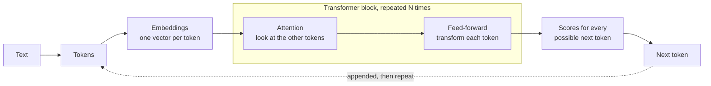
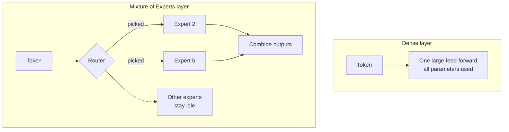
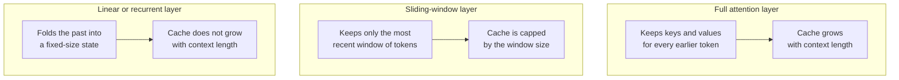

# Model Architecture

> **How a model is built shapes how it behaves.** Architecture explains why two
> models with similar quality can differ in speed, memory, and price.

We rarely choose an architecture directly. We see its effects: how fast tokens
stream, how much context fits, and what a deployment costs. This primer follows
one token through a model, then reads real architecture fact sheets from the
[LLM Architecture Gallery](https://sebastianraschka.com/llm-architecture-gallery/),
which collects diagrams and key numbers for more than 100 models.

## What happens to a token?

Nearly every modern language model is a stack of
[transformer](../GLOSSARY.md#transformer) blocks. Text becomes tokens, tokens
become vectors, and each block mixes information across the sequence before
predicting the next token.

Two parts of that block drive most of the differences we feel:

- **The feed-forward layer** holds most of a model's parameters. This is where
  dense and Mixture of Experts designs differ.
- **Attention** decides which earlier tokens matter, and it determines how much
  memory a long context needs. This is where attention variants and hybrids differ.

## How do we read a fact sheet?

The gallery gives each model a short card. Here is what each field tells us:

| Field | In plain words | Why we care |
|---|---|---|
| Scale | Total parameters, and for sparse models the active parameters and their share | Total hints at capacity and memory; active hints at per-token speed and cost |
| Context | How many tokens fit in one request | Whether our documents and history fit |
| Decoder type | Dense, Sparse MoE, or a hybrid | Which family of trade-offs applies |
| Attention | How tokens look at each other | Drives memory use at long context |
| Layer mix | How many layers of each attention kind | Shows where a hybrid saves memory |
| KV cache per token | Memory the model keeps for each token it has seen (bf16) | Tells us how fast memory grows as context grows |
| License | Terms for using and hosting the weights | Matters when we self-host |

## Dense or Mixture of Experts?

In a [dense model](../GLOSSARY.md#dense-model), every token passes through all the
feed-forward parameters. In a [Mixture of Experts](../GLOSSARY.md#mixture-of-experts-moe)
(MoE) model, each layer holds many smaller feed-forward blocks called experts,
and a small router picks a few for each token.

[Mixtral 8x7B](https://arxiv.org/abs/2401.04088) shows the idea: each layer has 8
experts and the router picks 2 per token, so a token has access to 47B parameters
but uses only 13B of them. Recent models take this much further. Here are
fact-sheet numbers from the gallery:

| Model | Type | Total parameters | Active per token | Active share |
|---|---|---|---|---|
| Llama 3 | Dense | 8B | 8B | 100% |
| Qwen3 30B-A3B | Sparse MoE | 30B | 3B | 10% |
| Qwen3 235B-A22B | Sparse MoE | 235B | 22B | 9.4% |
| GPT-OSS 120B | Sparse MoE | 117B | 5.1B | 4.4% |
| MiniMax M2 | Sparse MoE | 230B | 10B | 4.3% |
| DeepSeek V3 | Sparse MoE | 671B | 37B | 5.5% |

In these model names, `235B-A22B` reads as 235B total and 22B active. The takeaway:
**total parameters** hint at capacity and at the memory needed to host the model,
while **[active parameters](../GLOSSARY.md#active-parameters)** hint at per-token
speed and cost. A very large MoE can run closer to the speed of a mid-size dense
model, but its experts still have to be available in memory.

## What does attention cost?

Models keep the keys and values of every token they have already seen, so they
don't recompute the past. This [KV cache](../GLOSSARY.md#kv-cache) grows with
context length, and at long context it often matters more than parameter count.
Different attention designs shrink it in different ways:

| Design | Idea | Example from the gallery | KV cache per token (bf16) |
|---|---|---|---|
| Multi-head ([MHA](https://arxiv.org/abs/1706.03762)) | Every head keeps its own keys and values | GPT-2 XL | 300 KiB |
| [Grouped-query](../GLOSSARY.md#grouped-query-attention-gqa) ([GQA](https://arxiv.org/abs/2305.13245)) | Heads share key-value groups | Llama 3 8B | 128 KiB |
| Grouped-query, large MoE | Same idea at larger scale | Qwen3 235B-A22B | 188 KiB |
| [Multi-head latent](../GLOSSARY.md#multi-head-latent-attention-mla) ([MLA](https://arxiv.org/abs/2405.04434)) | Compress keys and values into a latent vector | DeepSeek V3 | 68.6 KiB |
| [Sliding-window](../GLOSSARY.md#sliding-window-attention) mixed with global | Most layers look only at nearby tokens | Gemma 3 27B (5:1) | 496 KiB |
| [Hybrid](../GLOSSARY.md#hybrid-attention) with linear layers | Replace most attention layers with a fixed-size state | Qwen3 Next 80B-A3B | 24 KiB |
| Hybrid with linear layers | Same idea with a different linear layer | Kimi Linear 48B-A3B | 7.9 KiB |

Read the table as a set of trade-offs, not a ranking. Gemma 3 27B uses sliding
windows yet still shows a high figure, because a wide model with many layers
stores a lot per token. The gallery computes these figures itself, so we use them
to compare designs, not as exact serving numbers.

Hybrids are the newest of these designs. Qwen3 Next mixes 12 gated-attention layers
with 36 DeltaNet layers (a 3:1 ratio, using [Gated Delta Networks](https://arxiv.org/abs/2412.06464)),
and Kimi Linear mixes 7 MLA layers with 20 Kimi Delta Attention layers. Because the
linear layers keep a fixed-size state, both show a very small cache per token and
support long contexts (262,144 and 1,000,000 tokens in the gallery).

## Which family is this?

The gallery labels each model's decoder type. Among its 109 models in early October
2026, Sparse MoE is the most common label, followed by Dense and then the hybrids.

| Decoder type | What it means | Reach for it when |
|---|---|---|
| Dense | All parameters work on every token | We want predictable behavior, or a small model that fits one GPU |
| Sparse MoE | Experts are selected per token | We want large capacity at lower per-token cost, and can host all the experts |
| Dense hybrid or Sparse hybrid | Mixes full attention with linear or windowed layers, with a dense or MoE feed-forward | Long context and low memory per token matter most |

Not every model is a decoder. Encoder-only models such as
[BERT](https://arxiv.org/abs/1810.04805) read a whole input and produce a
representation, which is the basis of [embeddings](embeddings.md) and classifiers,
and a starting point for some [decision models](decision-models.md).

## What does this look like in Foundry?

We can spot architecture choices in release notes:

- **Small bases for focused jobs.** Microsoft-Decision-1 is built on a 9B-parameter
  base model so that high-volume decisions stay fast and low cost.
- **Scale as a headline.** The Grok 4.6 announcement describes it as built on a
  1.5T-scale model family.
- **Design choices that surface as settings.** Cohere Embed V5 offers a range of
  Matryoshka embedding dimensions, so we can trade vector size against quality.

## What a model card may not tell us

Many providers don't publish architecture details or parameter counts,
especially for hosted models. When a card is quiet, we can still measure what
matters: latency, throughput, context behavior, and quality on our own tasks. See
[Model Cards](model-cards.md) for how to read what is there.

## Try it

1. Open the [gallery's compare tool](https://sebastianraschka.com/llm-architecture-gallery/)
   and pick a dense model and a Sparse MoE model. Note the total and active
   parameters and the KV cache per token.
2. Use the gallery's memory calculator for each, at the context length we need.
3. Pick two models from [CAPSULES](../CAPSULES.md), one large and one marked fast
   or flash. Send both the same prompts, then compare time to first token and
   total time.

## Key terms

[Transformer](../GLOSSARY.md#transformer) · [Dense model](../GLOSSARY.md#dense-model) ·
[Mixture of Experts](../GLOSSARY.md#mixture-of-experts-moe) ·
[Active parameters](../GLOSSARY.md#active-parameters) ·
[Attention](../GLOSSARY.md#attention) · [KV cache](../GLOSSARY.md#kv-cache) ·
[Grouped-query attention](../GLOSSARY.md#grouped-query-attention-gqa) ·
[Multi-head latent attention](../GLOSSARY.md#multi-head-latent-attention-mla) ·
[Sliding-window attention](../GLOSSARY.md#sliding-window-attention) ·
[Hybrid attention](../GLOSSARY.md#hybrid-attention)

## Learn more

1. [Microsoft Foundry Models overview](https://learn.microsoft.com/azure/foundry/concepts/foundry-models-overview)
2. [LLM Architecture Gallery (Sebastian Raschka)](https://sebastianraschka.com/llm-architecture-gallery/)
3. [Model benchmarks and leaderboards in Microsoft Foundry](https://learn.microsoft.com/azure/foundry/concepts/model-benchmarks)

_New to a term? See the [glossary](../GLOSSARY.md)._
