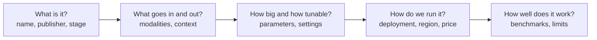

# Model Cards

> **A model card answers "should we build with this?"** It is a short document
> that travels with a model and describes what it does, how to run it, and where
> it falls short.

The idea comes from [Model Cards for Model Reporting](https://arxiv.org/abs/1810.03993),
which proposed short documents that accompany a model with its intended uses and
benchmarked performance. In the Foundry catalog, every model has one, and each
release capsule here links to it.

## How do we read a card?

Five questions get us most of the way:

## What is on a card?

| Section | What it tells us | Example from recent releases |
|---|---|---|
| Identity and stage | The name, publisher, version, and whether it is in preview or generally available | Grok 4.6 launched in public preview, then Grok 4.7 as generally available |
| Modalities | What the model accepts and produces | GPT-6.1 Sol takes text and images and produces text |
| Context window | How many tokens fit in one request, input and output together | GPT-6.1 Sol supports up to 1M tokens |
| Output limits | The most tokens one response can contain | Listed next to the context window |
| Parameters (size) | How big the model is | See the callout below |
| Request settings | Knobs we can set on each call | See the table below |
| Features | Tool calling, streaming, structured outputs, supported APIs | Grok 4.7 works with the Chat Completions and Responses APIs |
| Deployment | Where and how the model runs | Global Standard, Data Zone, Provisioned Throughput |
| Pricing | Rates per million tokens for input, output, and cached input | Some models price short and long prompts differently |
| Benchmarks | How the model scored on public tests | Often provider-reported, so compare with independent results |
| Safety and limits | Intended use, safeguards, and known weak spots | Claude Fable 5.1 adds safeguards that Claude Mythos 5.1 does not |

> **"Parameters" means two things.** On a card, *model parameters* describe size:
> the learned weights, sometimes split into total and active counts (see
> [Model Architecture](model-architecture.md)). *Request parameters* are the
> settings we choose on each call. Many cards do not publish a parameter count, so
> a missing number is normal.

## Which settings can we change?

| Setting | What it does | When we change it |
|---|---|---|
| Max output tokens | Caps the response length | To control cost and cut off rambling |
| Temperature and top-p | Control how varied the output is | Lower for consistent answers, higher for variety |
| Stop sequences | End generation at a given string | When output has a known end marker |
| Structured output schema | Constrains the reply to a format | When code reads the response |
| Reasoning effort | Sets how much the model thinks | Lower for simple tasks, higher for hard ones; Claude Haiku 5.5 and Claude Opus 5.5 both offer effort controls |
| Embedding dimensions | Sets the vector size | To trade storage and speed against quality; Cohere Embed V5 offers a range |

Not every model exposes every setting, and reasoning models may ignore some. The
card and API reference say which apply.

## Where does it run?

Deployment details decide cost, latency, and where our data goes:

- **Deployment type.** Global Standard offers the broadest region coverage and
  launches first for new models. Data Zone keeps processing within a Microsoft
  data zone (US, EU, or APAC). Provisioned Throughput reserves capacity. See
  [deployment types](https://learn.microsoft.com/azure/foundry/foundry-models/concepts/deployment-types).
- **Hosting.** The Claude Sonnet 5.5 announcement lists one option hosted on
  Azure and another hosted on Anthropic infrastructure, which changes where data
  is processed.
- **Availability stage.** Preview models can change and often carry no service
  level agreement, so check before planning production use.

Pricing changes often, so we link to the card rather than copy numbers here.

## What do we check before building?

1. **Stage and availability.** Is it generally available in our region?
2. **Fit.** Do the modalities and context window cover our inputs?
3. **Data boundary.** Does the deployment type keep data where we need it?
4. **Cost per task.** Estimate it from the token rates and a realistic prompt.
5. **Evidence.** Treat provider benchmarks as a starting point, then
   [evaluate on our own data](decision-models.md#try-it-on-our-own-data).

## Try it

Open the model card for a model in [CAPSULES](../CAPSULES.md). Fill in the five
questions above in a few lines, and note anything the card leaves unanswered.
Those gaps are exactly what a first notebook run can fill in.

## Learn more

1. [Understanding deployment types in Microsoft Foundry Models](https://learn.microsoft.com/azure/foundry/foundry-models/concepts/deployment-types)
2. [Foundry Models sold by Azure](https://learn.microsoft.com/azure/foundry/foundry-models/concepts/models-sold-directly-by-azure)
3. [Model Cards for Model Reporting](https://arxiv.org/abs/1810.03993)

_New to a term? See the [glossary](../GLOSSARY.md)._
