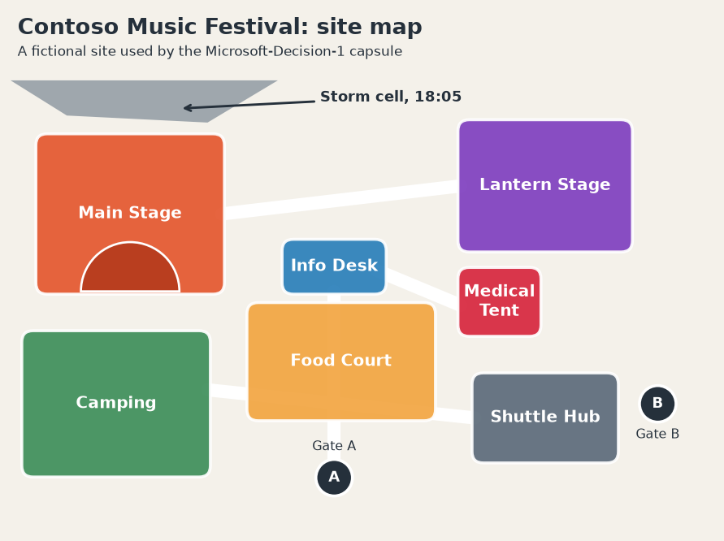
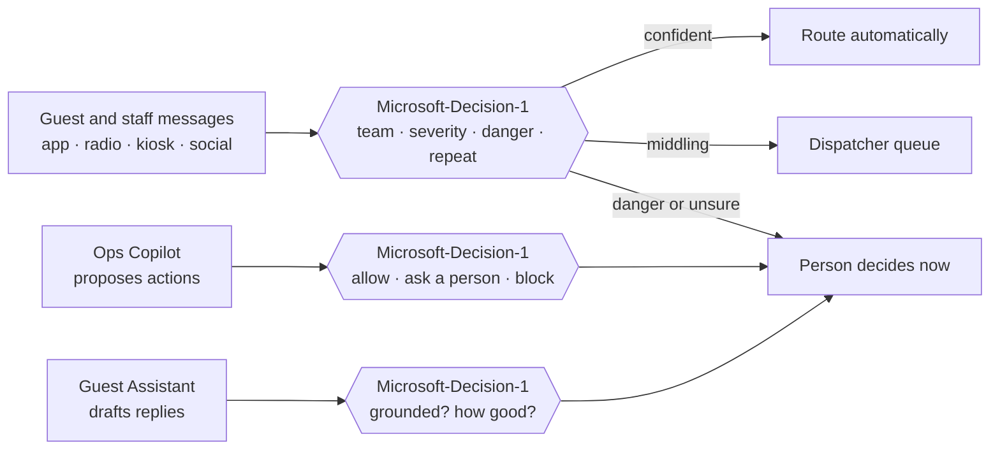

# Microsoft-Decision-1 — Release Capsule

**Released:** 2026-10-09 · **Publisher:** [Microsoft](../README.md) · **Capability:** Decision Models

Most steps in an AI application are decisions, not drafts: which team gets this, how bad is
it, may the agent run that action? Microsoft-Decision-1 answers closed questions about text
or JSON with a choice, a score, or a probability, so our code can branch on the answer. New to
the idea? Read the [decision models primer](../../../docs/primers/decision-models.md) first,
then come back to watch one work through a story.

> **Lifecycle.** The announcement describes Microsoft-Decision-1 as a public preview, while the
> model card lists it as generally available. Check the model card for the current status before
> planning production use.

## The scenario: the Contoso Music Festival ops desk



It's Saturday afternoon at the Contoso Music Festival, a fictional three-day music and food festival with
30,000 guests. A small ops desk keeps the site running. Messages reach it from the guest app,
staff radios, help desk kiosks, and social posts, and between 15:05 and 18:24 we follow 74 of
them. At 18:05 a storm cell arrives, and the desk gets busier and the stakes get higher.

Every message raises the same few questions, and the desk has seconds to answer them:

- Which team should handle this?
- How serious is it?
- Is someone in danger right now?
- Is it a repeat of a problem we already know about?

Two helpers add to the load. An **Ops Copilot** agent proposes actions such as dispatching a
team, sending a push notification, or issuing a refund. A **Guest Assistant** drafts replies from
the festival guide. Someone has to decide which actions may run and which replies may go out.



### How the model fits the scenario

The ops desk never needs Microsoft-Decision-1 to write anything. It needs fast, typed judgments
it can act on, and that is the model's job. Each notebook takes one slice of the desk's day.

| The desk asks | Question type | What comes back | Notebook |
|---|---|---|---|
| Which team handles this? | choice | The selected team, plus a probability for every team | [01](01-triage-festival-messages.ipynb) |
| How serious is it? | score | A position on a four-level scale, which can fall between levels | [01](01-triage-festival-messages.ipynb) |
| Is someone in danger? Is it a repeat? | noul (yes or no) | A probability from 0 to 1, with open incidents passed in as JSON state | [01](01-triage-festival-messages.ipynb) |
| Do we trust this call, or ask a person? | the probabilities themselves | Thresholds that sort decisions into automatic, queued, and human lanes | [02](02-set-confidence-thresholds.ipynb) |
| May the Ops Copilot run this action? | choice and noul | Allow, ask a person, or block, with the confidence behind it | [03](03-guard-and-grade-the-ops-copilot.ipynb) |
| Did the Guest Assistant stick to the guide? | choice with a "cannot tell" option | Supported, contradicted, or not covered by the evidence | [03](03-guard-and-grade-the-ops-copilot.ipynb) |
| How good is this draft? | score | A rubric grade we can compare with a person's | [03](03-guard-and-grade-the-ops-copilot.ipynb) |

Each notebook also breaks something on purpose, such as vague options, a threshold that misses
emergencies, or an agent action that slips through. We then find the cause in the probabilities
and fix it. That is where most of the learning happens.

> **Decision support, not decision-maker.** The model card says Microsoft-Decision-1 shouldn't
> be the sole basis for consequential decisions about people. The scenario follows that rule:
> anything that involves danger, a named guest, or a mass message goes to a person, and the model
> speeds up everything else.

## Before You Begin

| Detail | Value |
|---|---|
| Model card | [Microsoft-Decision-1 — Foundry catalog](https://ai.azure.com/catalog/models/Microsoft-Decision-1) |
| Docs | [Deploy and use Microsoft-Decision-1](https://learn.microsoft.com/azure/foundry/foundry-models/how-to/use-foundry-models-microsoft-decision) |
| Announcement | [Introducing Microsoft-Decision-1](https://techcommunity.microsoft.com/blog/azure-ai-foundry-blog/introducing-microsoft-decision-1-in-microsoft-foundry-for-decision-and-classific/4562742) |
| Pricing | See the Pricing tab on the model card |
| Release date | 2026-10-09 |
| Deployment types | `GlobalStandard`, and `DataZoneStandard` in selected regions |
| Inputs and limits | Text or JSON state, up to 32K tokens, and no images or audio |

Complete [models/quickstart/](../../quickstart/README.md) for first-time Foundry setup, then
deploy the model and save its name to `.env`:

```bash
./scripts/3-deploy-model.sh decision-1 Microsoft-Decision-1 --env-var AZURE_DECISION_1_DEPLOYMENT
```

**Required environment variables:**

```text
MICROSOFT_FOUNDRY_ENDPOINT      # shared quickstart setting
MICROSOFT_FOUNDRY_API_KEY       # shared quickstart setting
AZURE_DECISION_1_DEPLOYMENT     # your deployment name, for example Decision-1
```

The notebooks call the decision endpoint, `<resource>/providers/microsoft/v1/systemone`, with
`requests` and an API key. The model's Learn guide shows Microsoft Entra ID authentication too.

> **Capacity and rate limits.** A new deployment starts small. In testing, a capacity-1
> deployment returned `429 Too Many Requests` once we sent eight requests at a time, so the
> notebooks use four workers and retry with backoff. Pass `--capacity` to the deploy script to
> raise the limit.

## What you'll learn

- Ask choice, score, and noul questions in one request, and combine them over JSON state.
- Read the probabilities, not just the winning answer, and use an abstention option.
- Check whether the model's confidence matches its accuracy, then set thresholds by the cost of
  each mistake.
- Put a decision model between an agent and the world to gate actions, check groundedness, and
  grade drafts.

## Notebooks

| Notebook | What you'll learn |
|---|---|
| [01-triage-festival-messages.ipynb](01-triage-festival-messages.ipynb) | Route, rank, and gate messages in one request, then fix vague options with an abstention choice |
| [02-set-confidence-thresholds.ipynb](02-set-confidence-thresholds.ipynb) | Run the whole shift, check calibration, pick thresholds that don't miss emergencies, and render an ops wall |
| [03-guard-and-grade-the-ops-copilot.ipynb](03-guard-and-grade-the-ops-copilot.ipynb) | Gate agent actions, check replies against the guide, grade them against a rubric, and screen a social wall |

Each notebook is independently runnable. Output goes to `output/`, which is created at runtime
and isn't committed.

## The data

Everything the notebooks read is in [`assets/`](assets/), written for this capsule, with no real
people or events. The map script is there too, so the image can be regenerated.

| File | What it holds |
|---|---|
| [`messages.json`](assets/messages.json) | 74 messages with the expected team, severity, danger flag, and repeat flag, including eight vague ones |
| [`agent-actions.json`](assets/agent-actions.json) | 20 actions the Ops Copilot proposes, with the expected autonomy level |
| [`assistant-replies.json`](assets/assistant-replies.json) | 20 Guest Assistant drafts, with a groundedness label and a human grade |
| [`festival-guide.md`](assets/festival-guide.md) | The evidence the Guest Assistant may use |
| [`social-posts.json`](assets/social-posts.json) | 12 social posts for a moderation exercise |
| [`contoso-music-festival-map.png`](assets/contoso-music-festival-map.png) | The site map, drawn by [`make_map.py`](assets/make_map.py) |

## Know the boundaries

- The model returns numbers, not reasons. When a decision looks wrong, we inspect the
  probabilities and our option wording instead of asking it to explain.
- Wording matters. Vague or overlapping options produce confident wrong answers, which notebook
  01 shows and fixes.
- Calibration is a claim to check on our own data. Notebook 02 does that, then compares two ways
  to handle a confident mistake: raise the confidence bar, or fix the option wording.
- Probabilities can shift a little when the same request is sent again, so the numbers in your
  runs will differ slightly from the ones described here. Leave a margin around any threshold.
- It isn't a writer. Drafting, summarizing, and explaining belong to a generative model, and
  Microsoft-Decision-1 can check that model's work.
- Don't use it as the only basis for decisions about people, such as credit, employment, housing,
  healthcare, or legal matters. Keep meaningful human review in the loop.

## Beyond the festival

The same pattern fits other desks: support-ticket routing, incident triage, search relevance,
safety screening, and tool selection for an agent. Notebook 03 ends by screening a social
wall for harmful posts with a yes-or-no question, and the primer lists more
[ways to use a decision model](../../../docs/primers/decision-models.md).

## References

- [Deploy and use Microsoft-Decision-1 in Microsoft Foundry](https://learn.microsoft.com/azure/foundry/foundry-models/how-to/use-foundry-models-microsoft-decision) — deployment, request and response shapes, question types, limits, and best practices.
- [Microsoft-Decision-1 model card](https://ai.azure.com/catalog/models/Microsoft-Decision-1) — capabilities, intended uses, out-of-scope uses, and lifecycle.
- [Introducing Microsoft-Decision-1 in Microsoft Foundry](https://techcommunity.microsoft.com/blog/azure-ai-foundry-blog/introducing-microsoft-decision-1-in-microsoft-foundry-for-decision-and-classific/4562742) — release context and use cases.
- [Decision models primer](../../../docs/primers/decision-models.md) — what a decision API is and when to use one.
- [Model cards primer](../../../docs/primers/model-cards.md) — how to read a model card before relying on a model.
- [Glossary](../../../docs/GLOSSARY.md) — terms used across the capsule.
