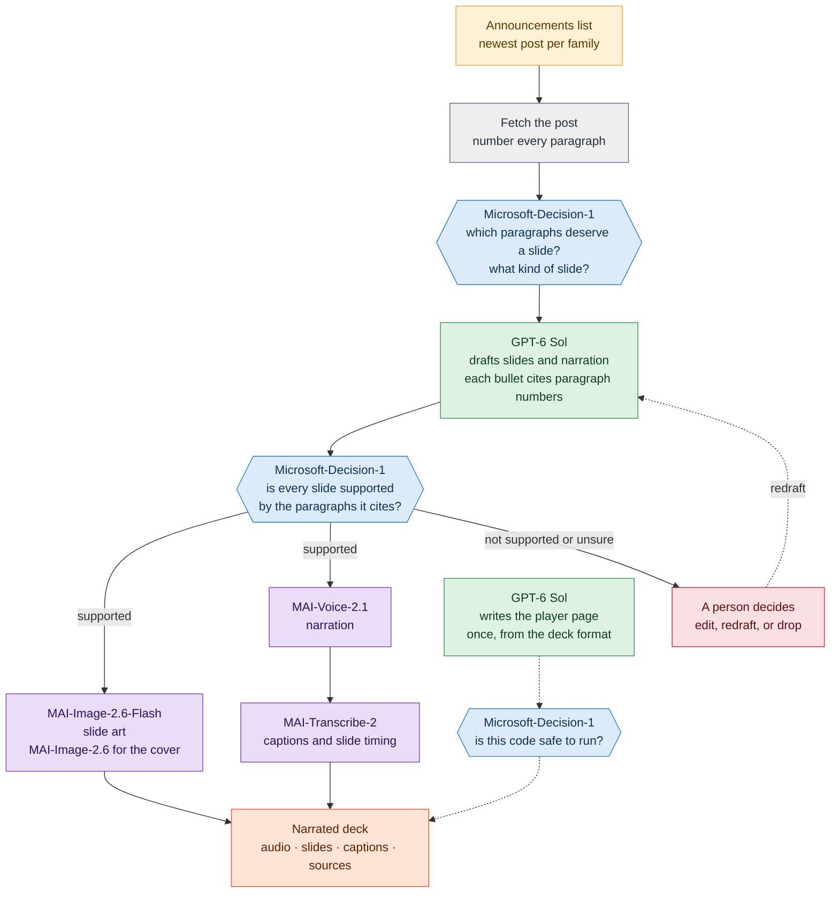
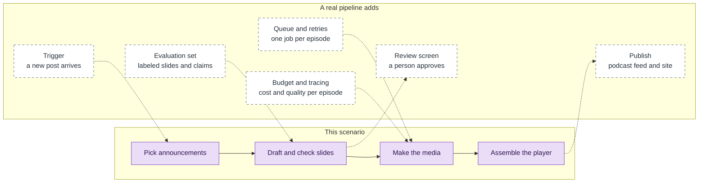

# Foundry Podcast Studio — Scenario

**Scope:** cross-publisher · **Capabilities:** Audio / Speech · Image Generation · Decision Models · Chat Completion

Every week brings new model announcements, and nobody has time to read them all. This scenario turns
each one into a short narrated deck that we can listen to: slides drawn for the topic, a voice reading
them, captions that follow along, and a link from every claim back to the sentence it came from. It uses
models from three families, each for the job it's best at, and it shows how they fit together.

> **Inspired by a weekly show.** The format borrows from Model Mondays, a weekly podcast about models.
> A weekly show needs a repeatable loop, so the scenario builds one episode end to end and shows where a
> real pipeline would add scheduling, review, and publishing. The sample sets the stage for that work.

## The story

Monday morning, a new post lands in the [announcements list](../../../docs/ANNOUNCEMENTS.md).
We want a two-minute episode by lunchtime, and we want to be sure it doesn't say anything the post doesn't say.

One model can't do all of that well, and one model shouldn't be trusted to check its own work.
A small decision model picks the parts of the post worth a slide. A larger language model writes the
words. The decision model then checks every slide against its source, and a person looks at anything
it isn't sure about. Only then do the image, voice, and transcription models make the episode.

## How the pieces fit



Purple boxes are MAI models, blue is Microsoft-Decision-1, green is OpenAI, red is a person, and grey is our own code.
The dotted path on the right is a side job. It runs once to produce the player page, and the page is
reviewed before anyone opens it.

## Who does what

Each model has one job, picked for what the job needs.

| Step | Model | Family | Why this model |
|---|---|---|---|
| Score paragraphs and pick slide types | [Microsoft-Decision-1](../../microsoft/microsoft-decision-1/README.md) | Microsoft | Typed answers over many short inputs, with a "cannot tell" option |
| Draft slides and narration | [GPT-6 Sol](https://ai.azure.com/catalog/models/gpt-6-sol) | OpenAI | This step writes, so it needs a generative model |
| Check each slide against its source | [Microsoft-Decision-1](../../microsoft/microsoft-decision-1/README.md) | Microsoft | A choice of supported, contradicted, or cannot tell, as in [notebook 03](../../microsoft/microsoft-decision-1/03-guard-and-grade-the-ops-copilot.ipynb) of that capsule |
| Slide art | [MAI-Image-2.6-Flash](https://ai.azure.com/catalog/models/MAI-Image-2.6-Flash) | MAI | Faster, for many images |
| Cover art | [MAI-Image-2.6](https://ai.azure.com/catalog/models/MAI-Image-2.6) | MAI | The full model, for the one image people see first |
| Narration | [MAI-Voice-2.1](https://ai.azure.com/catalog/models/MAI-Voice-2.1) | MAI | Expressive speech, with two prebuilt hosts |
| Captions and slide timing | [MAI-Transcribe-2](../../microsoft-ai/mai-transcribe-2/README.md) | MAI | Word timestamps and speaker labels |
| Write the player page | [GPT-6 Sol](https://ai.azure.com/catalog/models/gpt-6-sol) | OpenAI | Front-end code is generated text, so the same model that drafts the slides can write it |
| Review the generated code | [Microsoft-Decision-1](../../microsoft/microsoft-decision-1/README.md) | Microsoft | Yes-or-no questions about what the code does |

Because each job is a deployment named for the job, such as `slide-writer`, swapping GPT-6 Sol for a newer
model is a one-line change. One model can hold two jobs, as GPT-6 Sol does here. Mixing families works because
the steps only pass JSON, audio, and images to each other.

## Two notebooks

| Notebook | What we build | What breaks, and how we fix it |
|---|---|---|
| [01-primer-podcast-model-cards.ipynb](01-primer-podcast-model-cards.ipynb) | Two hosts, Harper and Grant, walk through the real model cards of three models used in this scenario, with a player that shows the card lines each host cites | Product names come back mangled in the transcript. We find the cause in the word-level differences and fix it with a phrase list |
| `02-release-notes-radio.ipynb` | A narrated deck for each announcement we pick, with every bullet linked to its source, and a radio page that lists the episodes | The drafting model invents a number. The grounding check catches it, we tighten the instructions, and we verify the slide again. The generated player page is reviewed before it runs, and the review can send it back |

The notebooks are written in this order and run on their own. They follow the same loop: build the
smallest working path, look at the evidence, break one thing on purpose, diagnose it, and fix it.

### How many episodes?

Notebook 02 has one setting that controls the size of the demo:

```python
EPISODE_COUNT = 3   # 3 to 5 works well; change it and rerun
```

The notebook reads the announcements list, keeps the **newest announcement for each family**, orders them
by date, and takes the first `EPISODE_COUNT`. A family is the publisher in the list, so each episode comes
from a different one. On 2026-10-12 the list has seven families, so the setting can go up to seven:

| `EPISODE_COUNT` | Episodes, newest first |
|---|---|
| 3 | Microsoft-Decision-1, Claude Haiku 5.5, Grok 4.7 |
| 4 | the three above, plus Cohere Embed V5 Pro |
| 5 | the four above, plus GPT-6.1 Sol |

The list changes every week, so the notebook reads it at run time and the table above will drift. Two optional
settings narrow the choice, `INCLUDE_FAMILIES` and `EXCLUDE_FAMILIES`. Cost and time grow in a straight line
with the count, since each episode runs the whole pipeline once. The cover art deployment has a capacity of 1,
so those requests run one after another to stay inside its rate limit.

## Guardrails: how we keep the episodes honest

A narrated episode sounds authoritative, so it's worth being careful about what it says.

- **Every claim cites its source.** Slides carry paragraph numbers, and the player links each bullet to the
  sentence it came from.
- **A second model checks the first.** Microsoft-Decision-1 judges each slide against the paragraphs it cites
  and can answer "cannot tell". Plain code backs it up by confirming that every cited paragraph exists and that
  every number and date in the narration appears in them.
- **A person handles the doubtful ones.** Slides that aren't supported go back for a redraft or an edit.
  The model card says Microsoft-Decision-1 shouldn't be the only decision-maker for consequential choices, and
  here it decides what a person needs to look at.
- **Synthetic voices are labeled.** The player says the audio is generated. We use prebuilt voices and never
  voice cloning.
- **Generated code is reviewed before it runs.** The player page is checked for network requests, unescaped
  text, and dynamic code, and announcement text is always escaped before it goes into the page.

## Before You Begin

Complete [models/quickstart/](../../quickstart/README.md) for first-time Foundry setup, then deploy the
models. Name each deployment for its job:

```bash
./scripts/3-deploy-model.sh decision-1   Microsoft-Decision-1 --env-var AZURE_DECISION_1_DEPLOYMENT
./scripts/3-deploy-model.sh slide-writer gpt-6-sol            --env-var AZURE_SLIDE_WRITER_DEPLOYMENT
./scripts/3-deploy-model.sh slide-art    MAI-Image-2.6-Flash  --env-var AZURE_SLIDE_ART_DEPLOYMENT
./scripts/3-deploy-model.sh cover-art    MAI-Image-2.6        --env-var AZURE_COVER_ART_DEPLOYMENT
```

MAI-Voice-2.1 and MAI-Transcribe-2 are called through Azure Speech with the project key, so they need no
deployment. GPT-6 Sol also writes the player page, so it needs no extra deployment. The scenario ships a
reference player. The generated page is compared with it, and the notebook falls back to it if the generated
code fails the review.

**Required environment variables:**

```text
MICROSOFT_FOUNDRY_ENDPOINT        # shared quickstart setting
MICROSOFT_FOUNDRY_API_KEY         # shared quickstart setting
AZURE_DECISION_1_DEPLOYMENT       # Microsoft-Decision-1
AZURE_SLIDE_WRITER_DEPLOYMENT     # GPT-6 Sol, for slides and the player page
AZURE_SLIDE_ART_DEPLOYMENT        # MAI-Image-2.6-Flash
AZURE_COVER_ART_DEPLOYMENT        # MAI-Image-2.6
```

Several of these models are previews or newly released, so check each model card for its current status
before relying on one.

### What it costs

Prices below are from the model cards on 2026-10-12. Check them again before budgeting.

| Piece | Rate | For one 3-minute episode |
|---|---|---|
| Narration, MAI-Voice-2.1 | $22 per 1M characters | about 2,700 characters, so about $0.06 |
| Captions, MAI-Transcribe-2 | $0.10 per hour early-bird, and $0.36 per hour at the standard rate | about $0.005 to $0.02 |
| Images, MAI-Image-2.6 and Flash | Per token. The cards point to the pricing page and don't list a rate | The response reports the tokens. In our tests a 1024×1024 image used 1,024 output tokens on both models |
| Slides and the player page, GPT-6 Sol | Per token | Depends on the post length, and the notebook prints the tokens used |
| Checks, Microsoft-Decision-1 | Per token | Short requests, and the notebook prints the tokens used |

Notebook 01 turns the token counts into a cost table once you enter the current rates. Retakes and reruns
multiply every line, so plan for several runs while developing.

## From this sample to a real pipeline

A notebook proves the idea. A weekly show needs more around it, and this scenario is built so that each
addition has an obvious place to go.



| In this scenario | In a real pipeline |
|---|---|
| We pick announcements by hand, with `EPISODE_COUNT` | A trigger starts a job when a new post appears, and the repo's blog scanner is a starting point |
| Each cell runs once, in order | A queue runs one job per episode, with retries and idempotent steps so a rerun doesn't pay twice |
| We read the unsure slides in the notebook | A review screen shows the slide, its source sentence, and the decision probabilities, and records who approved it |
| We check a handful of slides by eye | An evaluation set of labeled slides and claims tracks grounding accuracy whenever a model or prompt changes |
| The notebook prints tokens and timings | Traces and a budget per episode show cost and quality over time, and alert when either drifts |
| We open the player locally | The episode is published to a podcast feed and a site, with the transcript and sources attached |
| Deployments are named for jobs | Models, prompts, and templates are pinned and versioned, so an episode can be reproduced and a retirement date is a planned change |

For a design that turns this scenario into a hosted agent we can prompt, with the finished video stored in
Azure Storage, and for an alternative built from several agents that talk over the A2A protocol, see the
[appendix](appendix-hosted-agent.md).

## Know the boundaries

- **The checks reduce mistakes and don't remove them.** A decision model works within the options we give it,
  and its probabilities shift a little between runs. Keep a person in the loop for anything published.
- **Announcements are marketing copy.** The episode repeats what the post says. It doesn't verify the claims.
- **Source access varies.** Some publisher sites block automated requests, so the notebook reads the Tech
  Community and Azure blog links from the announcements list, and it says so when a post can't be fetched.
- **Generated code is untrusted code.** Review and test it before it runs, whichever model wrote it.
- **Voices are synthetic.** Say so in anything we publish, and don't use a voice to imitate a real person.

## References

- [Model cards primer](../../../docs/primers/model-cards.md) — how to read a card before relying on a model.
- [Decision models primer](../../../docs/primers/decision-models.md) — choice, score, and yes-or-no questions, and when to use them.
- [Audio / Speech primer](../../../docs/primers/audio-speech.md) — speech synthesis and transcription background.
- [Image generation primer](../../../docs/primers/image-generation.md) — what the image models take in and return.
- [Microsoft-Decision-1 capsule](../../microsoft/microsoft-decision-1/README.md) — the question types and the grounding pattern used here.
- [MAI-Transcribe-2 capsule](../../microsoft-ai/mai-transcribe-2/README.md) — speaker labels, word timestamps, and phrase lists.
- [Deploy and use Microsoft-Decision-1](https://learn.microsoft.com/azure/foundry/foundry-models/how-to/use-foundry-models-microsoft-decision) — official request and response shapes.
- [MAI voices in Azure Speech](https://learn.microsoft.com/azure/ai-services/speech-service/mai-voices) — prebuilt voices, styles, and gated features.
- [Deploy and use MAI image models in Microsoft Foundry](https://learn.microsoft.com/azure/foundry/foundry-models/how-to/use-foundry-models-mai-image?tabs=python) — the image generation API and its limits.
- [Glossary](../../../docs/GLOSSARY.md) — plain-language definitions for the terms used here.
