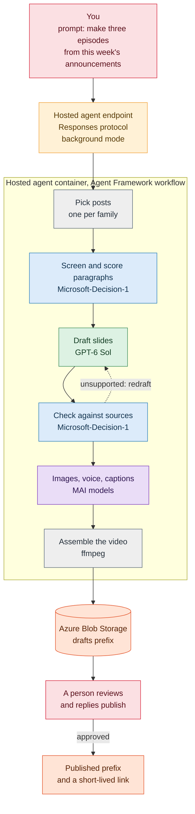
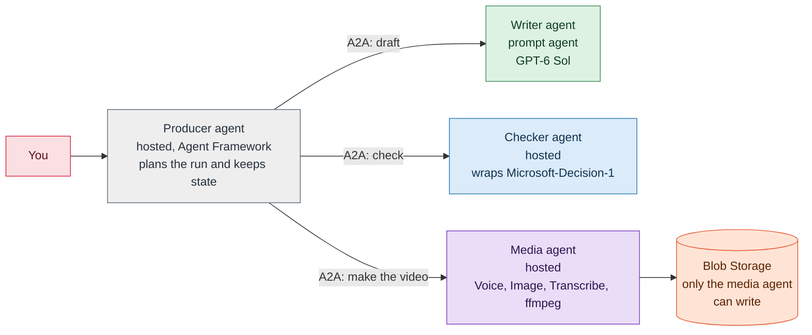

# Appendix: from this scenario to a hosted agent you can prompt

This appendix is a design recommendation, not a tested build. It describes how to turn the
[Foundry podcast studio](README.md) into a service we can prompt, such as "make three episodes from this
week's announcements", and that returns a finished **video file stored in Azure Storage**. It covers two
ways to build it: one hosted agent that calls tools, and a set of cooperating agents that talk over the
Agent2Agent (A2A) protocol. It ends with a recommendation for which to start with.

## What we checked, and what we didn't

The hosting facts below come from the Microsoft Learn pages listed in the references, read on 2026-10-12.
The designs themselves are proposals, and nobody has run them.

| Verified in the docs | Still to confirm before building |
|---|---|
| Hosted agents are containerized agents that run in Foundry Agent Service. We choose the framework, and Agent Framework, LangGraph, and custom code are all supported | Whether a hosted agent can install `ffmpeg`. A container image looks like the safe route, and the ZIP-based route builds from our source |
| Python and C# are supported | Which of our model and speech calls work with the agent's identity by default, and which need extra roles |
| Each session runs in its own VM-isolated sandbox with a persistent `$HOME` and `/files`, 0.5 to 2 vCPU and 1 to 4 GiB of memory | How long a single video build can run inside a session, and how that interacts with the idle timeout |
| Protocols: Responses, Invocations, Invocations over WebSocket, and A2A v1.0 (GA) and v0.3 (preview). The Responses protocol supports `background: true` with polling | The exact way an A2A tool is attached to a prompt agent. We found the A2A endpoint and A2A tools in the docs, and no step-by-step page |
| Every hosted agent gets its own Microsoft Entra identity. For our own Azure Storage we assign roles to that identity | Whether Microsoft-Decision-1's endpoint can be called with the agent identity |
| Sweden Central is in the hosted agents region list | Pricing for hosted runtime, which is billed on CPU and memory during active sessions |

## The target experience

We send one prompt to an endpoint, and we get back where the video is.

```text
Prompt:  Make a two-minute episode from the newest announcement in each of the first three families.
Reply:   Three episodes are ready for review. Draft videos are under episodes/2026-10-12/drafts/.
         Reply "publish" to move them to the shared container and get links.
```

What the service has to do:

1. Read the request and decide which announcements to use.
2. Run the same pipeline as notebook 02, with the same grounding checks.
3. Assemble a video from the slide images, the narration, and the captions.
4. Store the video and its companions in Azure Storage, and report where they are.
5. Wait for a person to approve before anything is shared.

## Approach A (recommended first): one hosted agent that calls tools

One agent, written with Microsoft Agent Framework, owns the whole job. The pipeline steps from the notebook
become tools and workflow steps inside it.



### How it works

- **Protocol.** Use the Responses protocol. The client can be any OpenAI-compatible SDK, and the platform
  keeps the conversation. A video build takes minutes, so the client sends `background: true` and polls. If
  the process might stop mid-build, opt in to resilient execution so the work resumes.
- **Workflow.** Model the steps as an Agent Framework workflow. The checker loop in the diagram is the
  maker-checker pattern that the Azure Architecture Center describes for validation and quality control.
- **Tools.** Each notebook helper becomes a tool with a narrow job and a typed result.

| Tool | Wraps | Returns |
|---|---|---|
| `list_announcements(count)` | The announcements list, newest per family | Rows with date, family, model, link |
| `fetch_post(url)` | The post fetch and paragraph numbering | Numbered paragraphs |
| `score_paragraphs(paragraphs)` | Microsoft-Decision-1 | A score and a slide type for each paragraph |
| `draft_deck(paragraphs)` | GPT-6 Sol | Slides with bullets, narration, and cited paragraph numbers |
| `check_deck(deck, paragraphs)` | Microsoft-Decision-1 plus plain checks | Supported, contradicted, or cannot tell for each slide |
| `make_media(deck)` | MAI-Image-2.6 and Flash, MAI-Voice-2.1, MAI-Transcribe-2 | Image files, audio files, word timestamps |
| `assemble_video(deck, media)` | `ffmpeg` | An MP4 and a caption file |
| `store_episode(episode)` | Azure Blob Storage | Blob paths |

- **Session and state.** Scratch files go in the session's `$HOME` or `/files`. The durable state store holds
  workflow checkpoints and the status of each episode, so a restart or an idle eviction doesn't lose work.
- **Idempotency.** Key each episode by the announcement URL and the versions of the models and prompts that
  produced it. If the key already exists in storage, return the stored episode instead of paying for it twice.

### Storing the video

| Item | Proposal |
|---|---|
| Account and container | A storage account in the same region, with a private container named `episodes` |
| Layout | `episodes/<yyyy-mm-dd>/<family>-<slug>/drafts/episode.mp4`, then `.../published/episode.mp4` after approval |
| Companions | `captions.vtt`, `deck.json` with the cited sources, `thumbnail.png`, and `run.json` with model versions, token counts, and timings |
| Access | Give the agent's identity the **Storage Blob Data Contributor** role on the container. The docs say to assign roles for our own storage. Add **Storage Blob Delegator** if the agent issues user-delegation SAS links |
| Sharing | Return a short-lived user-delegation SAS link, and don't make the container public |
| Retention | A lifecycle rule that deletes `drafts/` after a set period, and keeps `published/` |

### Making the video

The notebook already produces everything a video needs. A video build joins them:

```bash
# One still image per slide, shown for as long as its narration lasts, plus the audio and captions.
ffmpeg -f concat -safe 0 -i slides.txt -i narration.wav -i captions.vtt \
       -map 0:v -map 1:a -map 2:s \
       -c:v libx264 -pix_fmt yuv420p -r 30 -vf "scale=1280:720" \
       -c:a aac -c:s mov_text -shortest episode.mp4
```

`slides.txt` lists each image with a `duration`, and the durations come from the word timestamps that
MAI-Transcribe-2 returns. Package `ffmpeg` in a container image, and size the sandbox for the largest episode we
expect. A 2 vCPU, 4 GiB sandbox is the largest size listed, so start there and measure.

### Identity and security

- **One identity per agent.** The agent's identity needs the storage role above and access to the model
  deployments. Keep secrets out of the image and out of environment variables, and use connections.
- **Treat fetched text as untrusted.** An announcement is outside text that goes into prompts. Ask
  Microsoft-Decision-1 whether a paragraph contains instructions aimed at an AI agent, which is one of the
  uses its documentation lists, and drop those paragraphs. Escape all text that goes into HTML.
- **Keep a person in the loop.** Nothing moves to `published/` without an approval. The approval can be a
  reply in the same conversation, and a Responses agent can also be published to Teams.
- **Label synthetic audio** in the video description, and never clone a voice.

### Operations

- **Observability.** The protocol libraries emit OpenTelemetry. Send it to Application Insights, and add
  attributes for episode key, family, token counts, and each check's result.
- **Right-sizing.** Compare observed CPU and memory peaks with the allocation, as the hosting docs suggest, and
  raise or lower the size in the next agent version.
- **Versions.** Each deployment creates an immutable agent version, so a bad prompt or template can be rolled
  back. Pin model and template versions in `run.json`.
- **Cost.** Per-episode costs are in the scenario README. Hosted runtime adds a charge for CPU and memory
  while a session is active. Cap `count`, set a token budget per episode, and retry `429` responses with
  backoff. The cover art deployment has a capacity of 1, so covers run one at a time.
- **Evaluation.** Keep a labeled set of slides and claims. Track grounding accuracy, how often a person edits a
  slide, cost per episode, and time to a draft, and rerun it whenever a model or prompt changes.

### Deploying it

The quickstart flow is `azd ai agent init`, `azd ai agent run` for a local test, then `azd provision` and
`azd deploy`, with `azd ai agent invoke` and `azd ai agent monitor` afterward. Declare the Responses protocol in
the agent definition. Choose container-image deployment so the image can include `ffmpeg`.

## Approach B (alternative): several agents that talk over A2A

Instead of one agent that owns every step, split the roles into agents that call each other. A2A is an
open protocol for agents to discover and call one another. Foundry hosted agents expose an A2A endpoint at
`{project_endpoint}/agents/{name}/endpoint/protocols/a2a`, with v1.0 generally available and v0.3 in
preview, and Foundry tools include an A2A tool.



### Is it viable?

Yes, as a mix of agent types. Pure prompt agents can't do all of it.

| Role | Can it be a prompt agent? | Why |
|---|---|---|
| Writer | Yes | It needs instructions, a model, and maybe a tool. Prompt agents are configured, not coded |
| Checker | Not directly | Microsoft-Decision-1 is called through its own decision endpoint, not as a chat model, so a prompt agent can't use it as its model. Wrap it in a hosted agent or expose it as a tool |
| Media | No | It calls Speech and image APIs, handles files, and runs `ffmpeg`, so it needs code in a hosted agent |
| Producer | Hosted | It plans the run, calls the others, and tracks state, which is code |

### What we gain

- **Separate ownership and release cycles.** The writer's prompt can change without touching the media code.
- **Least privilege.** Only the media agent's identity gets a Storage role. The writer and checker never see storage.
- **Reuse.** Another team's pipeline can call the checker agent for its own grounding checks.
- **Independent scaling and cost control.** Media work needs bigger sandboxes than the writer does.
- **Mixed languages.** A C# agent can sit next to a Python one.

### What it costs

- **More hops.** Each A2A call adds latency and another way to fail, and the Architecture Center advises using
  the lowest level of complexity that works.
- **Multiplied model calls.** Every agent spends tokens on its own instructions and context.
- **Large files don't belong in messages.** Pass blob paths between agents and keep the audio, images, and
  video in storage.
- **Tracing across agents.** We have to propagate trace context so one episode is one trace.
- **Protocol versions.** A2A v0.3 is a preview and v1.0 is generally available, so pin the version both sides use.
- **Long tasks.** A media job runs for minutes, so the Producer needs a way to start it, poll it, and recover.
  We haven't confirmed how A2A task handling lines up with that.

## Choosing between them

| Question | Lean toward A, one agent | Lean toward B, A2A agents |
|---|---|---|
| Who owns the steps? | One team | Different teams or release cycles |
| Do other pipelines need a step on its own? | No | Yes, such as the grounding checker |
| Must writes to storage be isolated? | One identity is acceptable | Only one agent may write |
| Do steps need different sizes or languages? | No | Yes |
| How much latency and cost overhead is acceptable? | As little as possible | Some, in return for separation |

**Recommendation.** Build Approach A first. Keep every step behind a tool with a typed input and output, so a
step can later move behind an A2A agent without rewriting the workflow. Move to B when ownership, isolation, or
reuse becomes a real need.

## A path from the notebook to the service

1. **The notebook, as it is now.** Prove the pipeline and the checks.
2. **One hosted agent, no storage.** Wrap the steps as tools, run the workflow, return a video in the session's
   files, and test it with the OpenAI-compatible client.
3. **Add storage, approval, and idempotency.** Write to Blob Storage with the agent identity, add the draft and
   published prefixes, and the approval step.
4. **Add evaluation and tracing.** Build the labeled set, trace every episode, and set budgets and alerts.
5. **Add the trigger and publishing.** Start a run when a new post appears, publish to a feed or site, and
   keep the transcript and sources with each episode.
6. **Split into A2A agents when it earns its place.** Start with the checker agent or the media agent.

## Questions to answer first

- Does a hosted agent let us install and run `ffmpeg`, and with what limits on session length and disk?
- Which calls work with the agent identity by default, and which need role assignments?
- How does an A2A tool attach to a prompt agent, and how do task status and long-running work behave?
- Can a Responses background run survive long media steps, and when do we need resilient execution?
- What does hosted runtime cost for a typical episode, next to the model and speech costs?

## References

- [Hosted agents in Foundry Agent Service](https://learn.microsoft.com/azure/foundry/agents/concepts/hosted-agents) — protocols, A2A endpoint, identity, sandboxes, sessions, state store, regions.
- [What is Microsoft Foundry Agent Service?](https://learn.microsoft.com/azure/foundry/agents/overview) — prompt agents compared with hosted agents.
- [Quickstart: Deploy your first hosted agent](https://learn.microsoft.com/azure/foundry/agents/quickstarts/quickstart-hosted-agent) — the `azd ai agent` commands and the Responses protocol setup.
- [AI agent orchestration patterns](https://learn.microsoft.com/azure/architecture/ai-ml/guide/ai-agent-design-patterns) — sequential, concurrent, group chat, handoff, and magentic patterns, and when a single agent is enough.
- [Agent Framework documentation](https://learn.microsoft.com/agent-framework/) — building agents and workflows.
- [Assign an Azure role for access to blob data](https://learn.microsoft.com/azure/storage/blobs/assign-azure-role-data-access) — granting the agent identity access to storage.
- [Create a user delegation SAS](https://learn.microsoft.com/rest/api/storageservices/create-user-delegation-sas) — short-lived links without account keys.
- [Foundry podcast studio](README.md) — the scenario this appendix extends.
