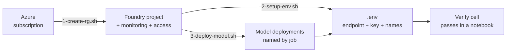

# Model Releases Quickstart

> **Do this once.** Every capsule notebook in this repo assumes you've finished the steps below. When a notebook can't find a required env var, it will point you back here.

The short version:

```bash
./scripts/1-create-rg.sh      # creates your Foundry project, monitoring, and access, then writes .env
./scripts/3-deploy-model.sh   # deploys the models a capsule needs (run with --help)
```

**Grounded in Microsoft Learn:**
- [Quickstart: Get started with Microsoft Foundry SDK](https://learn.microsoft.com/azure/foundry/quickstarts/get-started-code)
- [Overview of Microsoft Foundry Models](https://learn.microsoft.com/azure/foundry/concepts/foundry-models-overview)
- [Explore the Microsoft Foundry model catalog](https://ai.azure.com/catalog)

---

## What you'll set up



---

## 1. Prerequisites

- An **Azure subscription** where you can create resources and assign roles
  (Owner, or Contributor plus User Access Administrator, on the resource group).
- **Azure CLI**. The devcontainer and Codespaces already include it; otherwise
  [install it](https://learn.microsoft.com/cli/azure/install-azure-cli). The
  script signs you in, so you don't need to run `az login` first.
- **Python 3.10+** (the devcontainer ships 3.12) or open this repo in the
  provided devcontainer, which installs `requirements-dev.txt` for you.

## 2. Create a Foundry project

Run the script from the repo root:

```bash
./scripts/1-create-rg.sh
```

If you get a permission error, make the scripts executable first with
`chmod a+x scripts/*.sh`.

The script walks us through it:

1. **Signs you in** to Azure and lets you pick a default subscription.
2. **Asks for a resource group name and a location**, then shows what it will
   create and waits for a yes.
3. **Creates** the resource group, a Foundry resource, and a default project.
4. **Turns on monitoring**: Application Insights and Log Analytics, with the
   Foundry resource's logs sent to the workspace.
5. **Grants access**: Foundry User for you and the project, plus the Reader
   roles that tracing needs. The
   [script spec](../../scripts/1-create-rg.spec.md) lists every role and why.
6. **Offers to write `.env`** for you (step 3 below).

To preview without changing anything, add `--dry-run`. It's safe to re-run, and
existing resources are kept. If a role assignment needs someone with more
access, the script prints the exact commands to hand to an owner.

Prefer the portal? See
[Create a project in the Foundry portal](https://learn.microsoft.com/azure/foundry/how-to/create-projects).

## 3. Deploy the models a capsule needs

Each release capsule lists the exact deployments it expects in its
**Before You Begin** section. Find a model, then deploy it:

```bash
./scripts/3-deploy-model.sh --list mai
./scripts/3-deploy-model.sh image-flash MAI-Image-2.5-Flash --env-var AZURE_MAI_IMAGE_25_FLASH_DEPLOYMENT
```

The script fills in the model's format, version, deployment type, and capacity
from the catalog, and `--env-var` saves the deployment name to `.env`.

Name the deployment **by the job it does**, not the raw model name
(e.g. `router-nano`, `policy-mini`, `planner-gpt41`). That makes it easy to swap
models later without touching notebooks.

Full reference: [Deploy models using Azure CLI and Bicep](https://learn.microsoft.com/azure/foundry/foundry-models/how-to/create-model-deployments).

## 4. Check your `.env`

Script 1 offers to write `.env` for you. If you skipped that, or want to refresh
it, run:

```bash
./scripts/2-setup-env.sh --use <resource-group> <project-name>
```

The script copies [`scripts/sample.env`](../../scripts/sample.env) to `.env`, then reads
the endpoint and API key from the project and fills them in automatically.
Pass `--force` to overwrite an existing `.env`.

To load the variables into your current terminal session:

```bash
source .env
```

Full reference: [`scripts/2-setup-env.spec.md`](../../scripts/2-setup-env.spec.md).

These are the variables it sets:

| Variable | What it is |
|---|---|
| `MICROSOFT_FOUNDRY_ENDPOINT` | Your project's inference endpoint URL |
| `MICROSOFT_FOUNDRY_API_KEY` | Project API key (or use `azure-identity`) |
| `MICROSOFT_FOUNDRY_REGION` | Region you deployed into (e.g. `swedencentral`) |
| `<JOB>_DEPLOYMENT` | One per deployment used by the capsule you're running |

Capsules add capsule-specific vars in their **Before You Begin**. The
`.env` file is git-ignored — never commit it.

> **Entra ID auth.** Capsules that authenticate with `azure-identity` (for
> example the model router series) need only `MICROSOFT_FOUNDRY_ENDPOINT` plus
> `az login` — no API key — along with their own `<JOB>_DEPLOYMENT` var such as
> `AZURE_MODEL_ROUTER_DEPLOYMENT`.

## 5. Verify

Every capsule notebook opens with an **env precheck cell** that prints
✅ when your `.env` is complete and ⚠️ pointing back here when it isn't.
You can also run this one-liner from the repo root:

```bash
python -c "import os,dotenv; dotenv.load_dotenv(); \
required=['MICROSOFT_FOUNDRY_ENDPOINT','MICROSOFT_FOUNDRY_API_KEY']; \
missing=[v for v in required if not os.getenv(v)]; \
print('✅ base env OK' if not missing else f'⚠️ missing: {missing}')"
```

---

## Troubleshooting

- **`401 / 403`** — API key wrong, or your identity lacks the *Foundry User*
  role. Re-run `./scripts/1-create-rg.sh`, which assigns it, or see
  [Foundry RBAC](https://learn.microsoft.com/azure/foundry/concepts/rbac-foundry).
- **Can't create a deployment** — Foundry User can't deploy models. Ask an owner
  for *Foundry Account Owner* or *Cognitive Services Contributor* on the resource.
- **`404 model not found`** — deployment name in `.env` doesn't match
  what's in the portal. Match them exactly (case-sensitive).
- **Quota errors** — request a quota increase from the portal or pick a
  smaller model to start. See
  [Manage quotas](https://learn.microsoft.com/azure/foundry/how-to/quota).
- **Region mismatch** — a model isn't available in your region; deploy
  it to the region listed in the capsule's Before You Begin.

Still stuck? Open an issue against this repo with the failing cell's
output.
